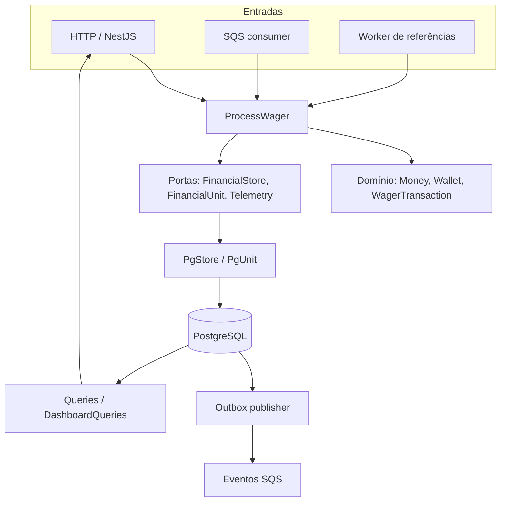
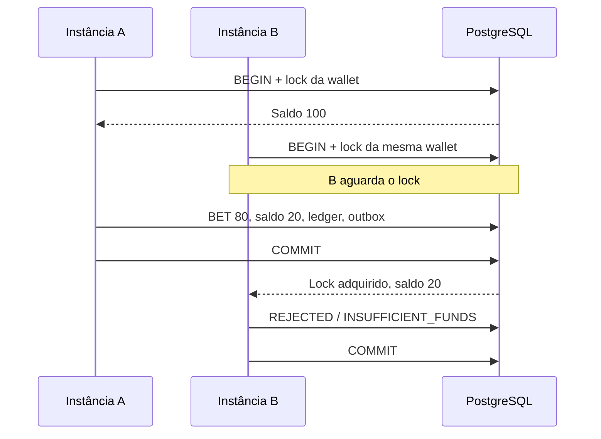
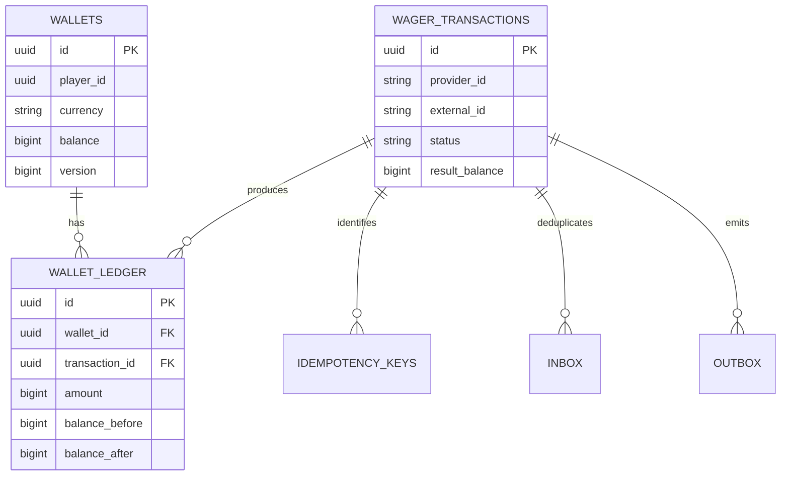
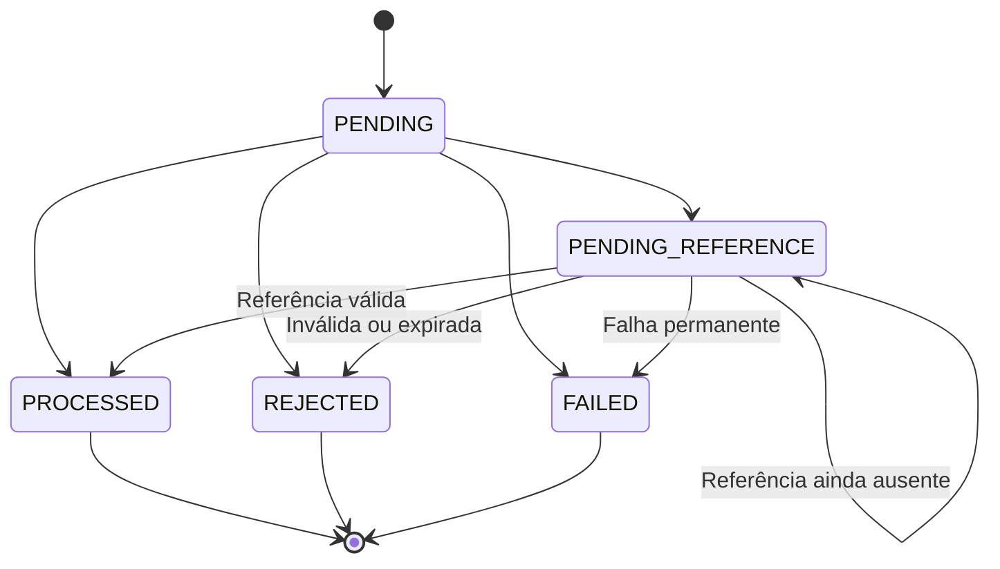
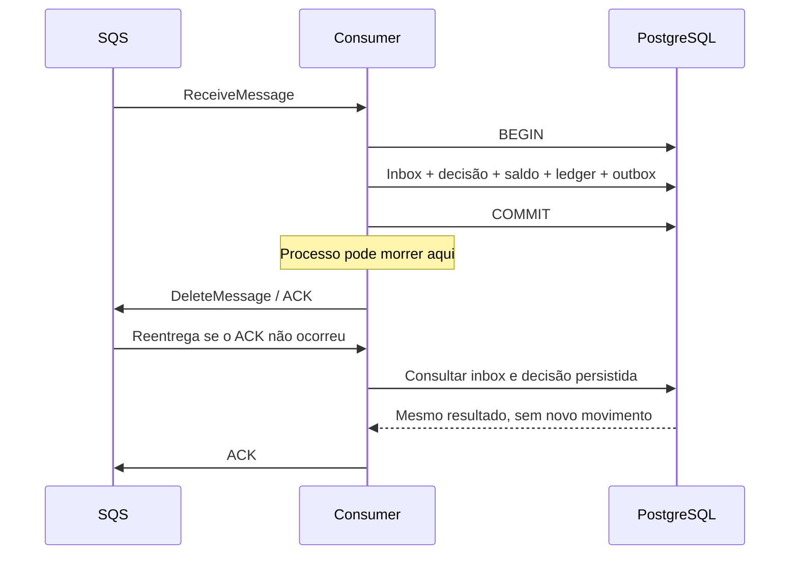
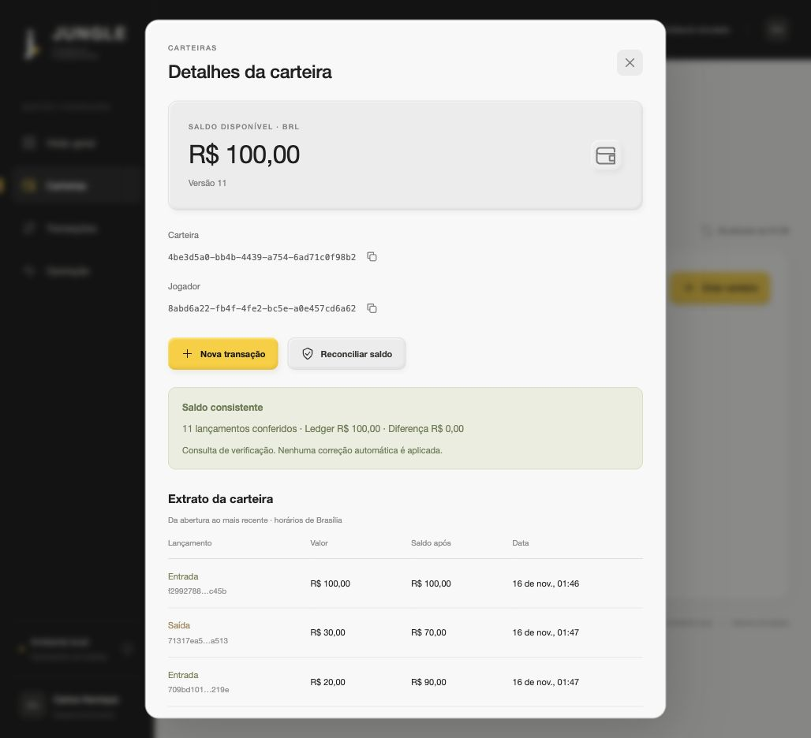

# Arquitetura

[Início](README.md) · [01](guide/iniciar.md) · [02](guide/api.md) · [03](guide/dashboard.md) · **04 · Arquitetura** · [05](guide/testes.md) · [06](openspec/README.md)

A regra central é simples: uma movimentação só existe quando a decisão e seus efeitos foram confirmados no PostgreSQL. O broker entrega trabalho e publica eventos; o navegador oferece uma forma de operar a simulação. Nenhum deles determina o saldo.

Essa separação permite explicar o comportamento em três momentos: quando duas operações disputam a mesma carteira, quando uma operação aparece novamente e quando um processo morre entre duas etapas.

## Fronteiras do código

```text
frontend/src/                 Interface, formulários e cliente HTTP
src/domain/                   Money, wallet, transações, ledger e eventos
src/application/              Caso de uso compartilhado, contratos e portas
src/http/                     Controllers e ponto de extensão de auth
src/infrastructure/           MikroORM, migrations, consultas, SQS e métricas
src/workers/                  Consumer, referências, publisher e shutdown
tests/                        Unidade, integração e processos de crash
scripts/                      Build, migrations, filas e verificação de links
.github/workflows/            Validação automática em GitHub Actions
guide/                        Instalação, contratos, dashboard e testes
openspec/                     Capacidades atuais e histórico de mudanças
assets/                       Capturas e botões da documentação
```



O domínio não importa Nest, MikroORM ou SDK AWS. Construtores privados, factories e métodos de reidratação mantêm as invariantes dentro das entidades. `ProcessWager` coordena a decisão; os adaptadores cuidam de HTTP, filas, SQL e observabilidade. As consultas de saldo, extrato e dashboard têm caminhos próprios de leitura.

`PgStore.atomic` cria um EntityManager com `fork().transactional()`. A wallet usa `EntitySchema`, Unit of Work e `PESSIMISTIC_WRITE`. Inbox, outbox, índices parciais e consultas específicas de PostgreSQL usam SQL parametrizado na mesma conexão e no mesmo contexto transacional. Isso mantém o domínio independente e deixa as regras de persistência verificáveis. Não há um segundo ORM nem geração automática de schema no startup.

As duas migrations versionadas são a fonte do schema. A primeira cria as tabelas e constraints; a segunda adiciona o índice de seleção de referências. O down da segunda preserva o histórico. O down da primeira remove as tabelas e seus dados.

## Concorrência: uma carteira por vez

O lock financeiro é a linha da wallet, nunca um lock global. A ordem principal é inbox, quando existe, depois wallet, identidades da operação, referência e escrita dos efeitos.



Em `READ COMMITTED`, a segunda instância lê o saldo após a primeira confirmar. Uma operação em outra wallet pode confirmar durante essa espera. Referências válidas pertencem à mesma wallet, então o mesmo lock também serializa as reversões; uma referência inválida não exige bloquear outra carteira.

Cada transação financeira usa `lock_timeout=2s`; as conexões também têm limites para statements e aquisição. Conflitos de unicidade, serialization failure, deadlock e timeout de lock permitem até cinco tentativas no caso de uso, com backoff de 10/20/40/80 ms e jitter. Uma tentativa começa com novo contexto transacional e entidades reidratadas. Se a infraestrutura continuar indisponível, HTTP retorna 503 ou o consumer agenda retry. O cliente mantém a identidade da operação.

O worker de referências seleciona uma pendência por wallet com `JOIN LATERAL` e adquire `FOR UPDATE OF w SKIP LOCKED` antes de limitar o lote. Assim, muitas pendências de uma carteira bloqueada não escondem trabalho de outra. Estado e prazo são relidos depois do claim.

**Provas:** os testes iniciam três processos Nest, enviam 50 duplicatas, disputam duas apostas de 80 sobre 100 e mantêm uma wallet bloqueada enquanto outra confirma. Há também um cenário com 26 referências de uma wallet ocupada para verificar que a seleção não bloqueia as demais.

## Modelo e defesas no banco



O diagrama mostra os vínculos do processamento; não pretende reproduzir cada coluna ou FK. Em particular, a transação guarda o `walletId` solicitado mesmo quando a carteira não existe, permitindo auditar a rejeição. O ledger exige uma wallet existente.

| Estrutura | Garantia |
|---|---|
| `wallets` | Jogador/moeda únicos; saldo não negativo e dentro da faixa; versão positiva |
| `wager_transactions` | Provedor/ID externo e chave original únicos; reversão processada única por referência/tipo |
| `idempotency_keys` | Cada alias globalmente único, ligado ao hash e à decisão |
| `wallet_ledger` | Uma entrada por wallet/transação; aritmética consistente; UPDATE, DELETE e TRUNCATE rejeitados |
| Inbox | Deduplicação persistente por consumidor/messageId |
| Outbox | Envelope e ID de evento persistentes, com agenda e lease de publicação |

Triggers diferidas verificam no commit a soma do ledger, a cadeia `before → after`, a versão da wallet e a correspondência de valor, moeda, direção e identidade entre decisão e lançamento. Transações terminais também são imutáveis por DML normal.

Uma abertura positiva confirma wallet na versão 1, transação OPENING, crédito a partir de zero e eventos juntos. Abertura zero não gera lançamento. LOSS e rejeições não mudam saldo/versão nem produzem `WalletBalanceChanged`. A versão é `1 + número de movimentos que não são OPENING`.

Essas verificações têm um custo: parte dos triggers percorre o histórico da carteira. É uma defesa adequada ao escopo da avaliação, mas exigiria validação incremental, estratégia de retenção e medição antes de crescer sem limite. O usuário local do banco é proprietário para permitir migrations e injeção de falhas; um administrador pode alterar triggers. Uma implantação real separaria os papéis de migration e DML.

## Dinheiro e regras de referência

`Money` é imutável. Usa centavos em `bigint`, persiste em `bigint` PostgreSQL e trafega como strings no driver e no JSON. O máximo é 9.999.999.999.999.999 centavos. BRL, USD e EUR formam o conjunto aceito, todos com duas casas. Não existe conversão cambial nem arredondamento implícito. Contadores, versões, tempos e métricas podem usar `number`; valores financeiros não.

BET debita, WIN credita e LOSS exige zero. REFUND inverte uma BET; ROLLBACK inverte BET, WIN ou REFUND, sempre pelo valor integral. Uma inversão de crédito também pode ser rejeitada por saldo insuficiente.

A referência precisa pertencer ao mesmo provedor, jogador, wallet, moeda e rodada. `gameId` participa do hash, mas não precisa coincidir na referência: a fonte exige identidade de rodada. WIN pode referenciar BET; BET e LOSS não aceitam referência. Uma referência terminal rejeitada ou falha não pode ser aplicada. Autorreferência é rejeitada.

A unicidade das reversões é por **tipo e referência**. Isso permite um REFUND e um ROLLBACK da mesma BET, conforme a regra do desafio. Impedir qualquer segundo estorno, independentemente do tipo, seria uma política diferente.



OPENING é criado internamente já processado e nunca entra pelos contratos externos. Métodos de domínio rejeitam novas transições de estados terminais.

## Idempotência: identidade e resultado histórico

Há três identidades complementares:

1. O header `Idempotency-Key` no HTTP, ou `data.idempotencyKey` no SQS, identifica uma tentativa lógica.
2. `(providerId, externalTransactionId)` identifica a operação no namespace do provedor.
3. `(consumer, messageId)` identifica uma entrega na inbox.

O hash SHA-256 cobre somente os campos de negócio: provedor/ID externo, wallet/jogador, rodada/jogo, tipo, valor/moeda e referência opcional. O JSON canônico ordena chaves e preserva strings, omitindo opcionais ausentes. UUIDs são normalizados para minúsculas. Header, correlação, messageId e horário de transporte não entram nesse hash.

| Chegada | Resultado |
|---|---|
| Mesma chave e mesmo negócio | Replay da decisão persistida |
| Mesmo provedor/ID externo, mesmo negócio, nova chave | Replay e vínculo do novo alias |
| Chave ou ID externo já ligados a outro negócio | Conflito, sem movimentação |
| Mesmo messageId e envelope compatível | Inbox retorna a decisão original |
| Mesmo messageId com negócio/chave diferentes | `INBOX_CONFLICT`, encaminhado à DLQ |

O saldo da resposta fica na transação, em `result_balance/result_currency`. Por isso o replay de uma aposta que deixou saldo 70 continua retornando 70 quando a carteira já voltou a 100. O saldo atual é consultado na wallet. Registros anteriores à normalização de UUIDs são comparados pelo negócio histórico normalizado sem reescrever hashes ou decisões terminais.

Uma corrida perdida no índice único desfaz a transação inteira. A nova tentativa reconsulta a identidade num contexto novo. Não há cache financeiro nem dependência da janela curta de deduplicação do broker.

## Recuperação após falhas

### Entrada: commit antes do ACK



Antes do commit, uma queda desfaz todos os efeitos. Depois dele, a inbox torna a reentrega segura. Uma rejeição de negócio ou referência pendente também recebe ACK: o resultado está persistido e o banco passa a possuir a pendência.

Falha de ACK não transforma uma operação confirmada em FAILED. Há até três tentativas próprias de ACK. Mesmo no último recebimento, um commit incerto é resolvido pela identidade durável antes de classificar a decisão. Quando o resultado persistido é FAILED, inclusive num replay após crash, o consumer conclui o envio à DLQ antes do ACK.

Falhas transitórias usam visibilidade com backoff exponencial de 1 segundo a 60 segundos, com cinco recebimentos por padrão. Contrato inválido, conflito e determinadas classes SQL permanentes não ficam repetindo indefinidamente. Mensagem válida com falha permanente ou orçamento esgotado gera FAILED auditável quando o banco está disponível. Se o banco permanecer inacessível, a redrive policy move a mensagem à DLQ; não é possível prometer uma auditoria SQL durante essa indisponibilidade.

O heartbeat estende a visibilidade sem chamadas sobrepostas. Ao pará-lo, o worker aguarda a extensão em andamento antes de alterar o prazo. SIGTERM interrompe novas iterações e drena o trabalho. SIGKILL é recuperado por visibilidade, inbox e leases. Reprocessamento manual da DLQ deve preservar o envelope e suas identidades.

### Referências fora de ordem

Uma referência ausente produz `PENDING_REFERENCE`, com contador, próximo horário e prazo persistidos. O worker usa backoff a partir de 1 segundo, teto de 300 segundos, até 12 adiamentos ou TTL de 24 horas. Com execução regular e defaults, os adiamentos somam aproximadamente 23m31s antes da próxima rejeição. Reiniciar não zera esses limites.

O TTL é verificado antes de aplicar uma referência que chegou tarde. Ao expirar, a transação é rejeitada com `REFERENCE_NOT_FOUND`. Consultas/replays enquanto pendente não criam eventos adicionais: são registrados a entrada na pendência e seu desfecho.

### Saída: outbox, lease e republicação

O envelope completo, versão e eventId entram no commit financeiro. Publishers fazem claim com `FOR UPDATE SKIP LOCKED`, lease de 10 segundos e token UUID. A chamada SQS acontece fora da transação financeira.

Antes de cada envio, o publisher revalida token, validade e ausência de `publishedAt`. Heartbeat só renova leases ainda válidas; perder a reserva impede enviar o restante do lote ou marcar o trabalho de outro publisher. A transição em memória para publicado ocorre depois da gravação confirmada, permitindo retry se o banco falhar após o envio.

| Ponto da falha | Retomada |
|---|---|
| Antes do commit financeiro | Nada é visível ao publisher |
| Depois do commit, antes do claim | Outro publisher encontra o evento |
| Depois do claim, antes do envio | Lease expira e pode ser recuperada |
| Depois do envio, antes de marcar publicado | Mesmo eventId pode ser enviado novamente |
| Falha persistente de publicação | Outbox conserva evento e agenda retry; lag fica observável |

Retries da outbox vão de 1 a 300 segundos e não descartam eventos confirmados por limite de tentativas. Uma chamada ao broker já em voo pode se duplicar mesmo com fencing. **Não há exactly-once no broker nem ordem total entre publishers ou entre HTTP e SQS.**

Cada consumidor downstream deve gravar `(consumer_name,event_id)` numa inbox própria e aplicar a projeção na mesma transação. ACK só depois do commit. Projeções de saldo também usam `walletVersion` e consultam a origem quando detectam lacunas. Se o efeito for outra chamada externa, essa chamada precisa de idempotência/outbox própria. O projeto demonstra republicação com ID estável; não implementa uma aplicação downstream fictícia.

## Contrato e códigos de resposta

Erros de contrato/transporte retornam `{ code, retryable }`. Decisões auditadas retornam `{ transactionId, status, balance, failureCode, idempotentReplay }`. Consultar uma decisão rejeitada retorna HTTP 200; a submissão/replay dessa rejeição retorna 422.

| Grupo | Códigos principais | Tratamento |
|---|---|---|
| Validação | `INVALID_PAYLOAD`, `INVALID_AMOUNT`, `UNSUPPORTED_CURRENCY`, `INVALID_AMOUNT_FOR_KIND`, `REFERENCE_REQUIRED`, `REFERENCE_NOT_ALLOWED`, `INVALID_KIND`, `IDEMPOTENCY_KEY_REQUIRED`, `INVALID_CURSOR`, `INVALID_LIMIT` | HTTP 400; corrigir contrato |
| Identidade | `IDEMPOTENCY_CONFLICT`, `EXTERNAL_ID_CONFLICT`, `WALLET_EXISTS` | HTTP 409; não trocar a chave cegamente |
| Consulta | `WALLET_NOT_FOUND`, `TRANSACTION_NOT_FOUND`, `NOT_FOUND` | HTTP 404 na consulta |
| Wallet | `WALLET_NOT_FOUND`, `PLAYER_MISMATCH`, `CURRENCY_MISMATCH`, `INSUFFICIENT_FUNDS`, `REVERSAL_INSUFFICIENT_FUNDS`, `BALANCE_LIMIT_EXCEEDED` | Rejeição auditada na submissão |
| Referência | `SELF_REFERENCE`, `REFERENCE_MISMATCH`, `REFERENCE_KIND_INVALID`, `REFERENCE_NOT_PROCESSED`, `REVERSAL_AMOUNT_MISMATCH`, `ALREADY_REVERSED`, `REFERENCE_NOT_FOUND` | Rejeição auditada; ausente primeiro pode ficar pendente |
| Transitório | `INFRASTRUCTURE_UNAVAILABLE` | HTTP 503; repetir mesma chave/corpo |
| Falha terminal | `INFRASTRUCTURE_PERMANENT_FAILURE`, `INFRASTRUCTURE_RETRIES_EXHAUSTED` | FAILED quando persistível; investigação/DLQ |
| Envelope SQS | `INVALID_MESSAGE`, `INBOX_CONFLICT` | DLQ; sem inventar uma decisão financeira válida |

Erros de invariantes internas indicam falha de programação. SQL e seus parâmetros não são expostos no contrato HTTP. A reconciliação apenas compara o saldo com a reconstrução do ledger e sinaliza divergência; não tenta corrigi-la.

## Dashboard e observabilidade

O React é servido na mesma origem por Nest. Não há conversão monetária para float, mesmo na formatação. A UI normaliza vírgula/ponto e completa centavos antes do contrato de duas casas. A lista de carteiras/transações usa keyset `(created_at,id)` com microssegundos e escopo de filtro; o ledger ainda conserva o limite superior da primeira página. Uma lista de decisões é uma visão viva: pendências podem mudar de status entre páginas.

O snapshot de envio é persistido em `sessionStorage` antes do POST. Resultado incerto mantém corpo e chave; uma resposta persistida permite uma nova operação, inclusive a referência ausente. O polling agenda a próxima chamada após a anterior terminar e apresenta erros transitórios. A reconciliação limpa o resultado anterior ao iniciar outra consulta. Fechar definitivamente a aba perde a recuperação local do rascunho, mas não a idempotência no servidor.



Os eventos versionados são `WagerTransactionProcessed`, `WagerTransactionRejected`, `WalletBalanceChanged`, `WagerTransactionPendingReference` e `WagerTransactionFailed`, derivados de `IntegrationEvent`. A versão atual é 1; os envelopes são copiados e persistidos como JSONB.

Logs estruturados incluem correlação, messageId, transactionId, walletId, providerId, status/código e timestamp. Não incluem payload completo, headers, URL do banco ou credenciais. Métricas Prometheus cobrem decisões, duplicatas, retries, DLQ, conflitos de lock, lag de outbox, latência e divergências de reconciliação. São por processo e reiniciam com ele; o ledger é a auditoria financeira. A redrive automática pode ocorrer sem incrementar a métrica local de DLQ.

Liveness verifica o processo. Readiness consulta banco e três filas. Uma submissão pode confirmar no banco enquanto SQS está indisponível, deixando o evento na outbox; readiness sinaliza essa indisponibilidade.

## Limites e próximos passos

A configuração é uma simulação local: não há IdP, autorização de provedor, dupla entrada contábil, benchmark de carga ou garantia de produção. O ponto de extensão de autenticação é `LocalOnlyAuthGuard`. O banco é persistido pelo Compose; o LocalStack está com persistência desabilitada e perde filas ao ser recriado.

Para uma integração autenticada, substituiria esse guard por validação OIDC de um IdP externo, como Keycloak: assinatura via JWKS, issuer, audience, expiração e escopos. A identidade autenticada seria vinculada ao provedor autorizado, em vez de confiar apenas no `providerId` enviado no corpo. Health permaneceria aberto; SQS seria um canal interno com acesso restrito à fila, preservando as validações de identidade do domínio. Não haveria cadastro de senhas próprio na aplicação.

Inbox, aliases, transações e ledger não têm limpeza automática. Remover identidades sem uma política de retenção mudaria as garantias de replay. Os read models da dashboard consultam o banco diretamente; volumes maiores pediriam análise de planos, índices e projeções incrementais. Nenhuma promessa de throughput ou entrega exatamente uma vez depende desta implementação.

O [índice OpenSpec](openspec/README.md) liga essas decisões às specs, ao código e aos testes. A base inicial foi consolidada retrospectivamente em 16/11/2026. Os registros arquivados distinguem essa adoção das mudanças posteriores, propostas antes da implementação.

---

← [Anterior: Dashboard](guide/dashboard.md) &nbsp; · &nbsp; [Voltar ao início](README.md) &nbsp; · &nbsp; [Próxima: Testes e CI →](guide/testes.md)
