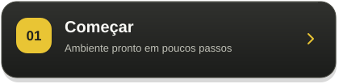
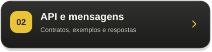
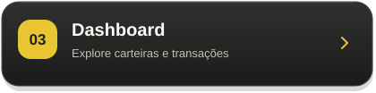
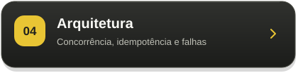
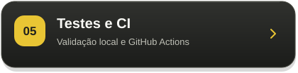
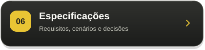

# Distributed Wagering Processor

**Uma decisão financeira consistente, mesmo com concorrência e reentregas.**

API de apostas simuladas com NestJS, PostgreSQL e SQS local. HTTP e fila usam o mesmo caso de uso; cada decisão fica registrada e o saldo pode ser reconstruído pelo ledger. A dashboard permite explorar esses fluxos sem montar requisições à mão.

[](https://github.com/cCarllus/distributed-wagering-processor/actions/workflows/ci.yml)

## Escolha por onde começar

Leia na ordem ou vá direto ao assunto. Cada página tem navegação para continuar a leitura.

<p>
  <a href="guide/iniciar.md"></a>
  <a href="guide/api.md"></a>
</p>

<p>
  <a href="guide/dashboard.md"></a>
  <a href="ARCHITECTURE.md"></a>
</p>

<p>
  <a href="guide/testes.md"></a>
  <a href="openspec/README.md"></a>
</p>

## Rode em um comando

Com Docker e Docker Compose instalados, dentro da pasta do projeto:

```sh
docker compose --profile app up -d --build --wait
```

Abra **[127.0.0.1:3100](http://127.0.0.1:3100/)** e crie a primeira carteira. Migrations e filas são preparadas automaticamente. O [guia de início](guide/iniciar.md) traz a alternativa com Bun, portas e comandos para preservar os dados.

> Simulação local, com valores e credenciais fictícios. A API não tem autenticação externa e as portas ficam em `127.0.0.1`; não exponha esta configuração na internet.

<details>
<summary><strong>Veja a dashboard em funcionamento</strong></summary>


</details>

## Três decisões centrais

| Decisão | Resultado |
|---|---|
| Lock de linha por carteira | Duas apostas de 80 sobre saldo 100 produzem um único débito. Carteiras diferentes avançam em paralelo. |
| Idempotência no PostgreSQL | Replays devolvem a decisão e o saldo originais; payload divergente gera conflito. |
| Inbox e outbox no mesmo commit | ACK depois da persistência; republicações mantêm o ID do evento para deduplicação. |

Dinheiro usa centavos em `bigint` e strings decimais no contrato. A suíte cobre concorrência, crash, reinício, DLQ, referências fora de ordem e reconstrução do ledger. A [arquitetura](ARCHITECTURE.md) explica as garantias e os limites; [Testes e CI](guide/testes.md) mostra como verificá-los.

**Stack:** Bun 1.3.14 · TypeScript strict · NestJS · MikroORM · PostgreSQL · LocalStack · React. Versões e imagens fixadas no projeto.

---

Implementação do [desafio da Jungle Gaming](https://github.com/junglegaming/backend-challenge/blob/c7143e6d041585d6913f56eb7415105e074f83dc/README.md), conferido na revisão `c7143e6d041585d6913f56eb7415105e074f83dc`. A dashboard é uma extensão opcional. Desenvolvimento assistido pelo Codex, sem consulta a soluções de candidatos ou forks. O [OpenSpec](openspec/README.md) distingue a adoção retrospectiva das mudanças posteriores.
