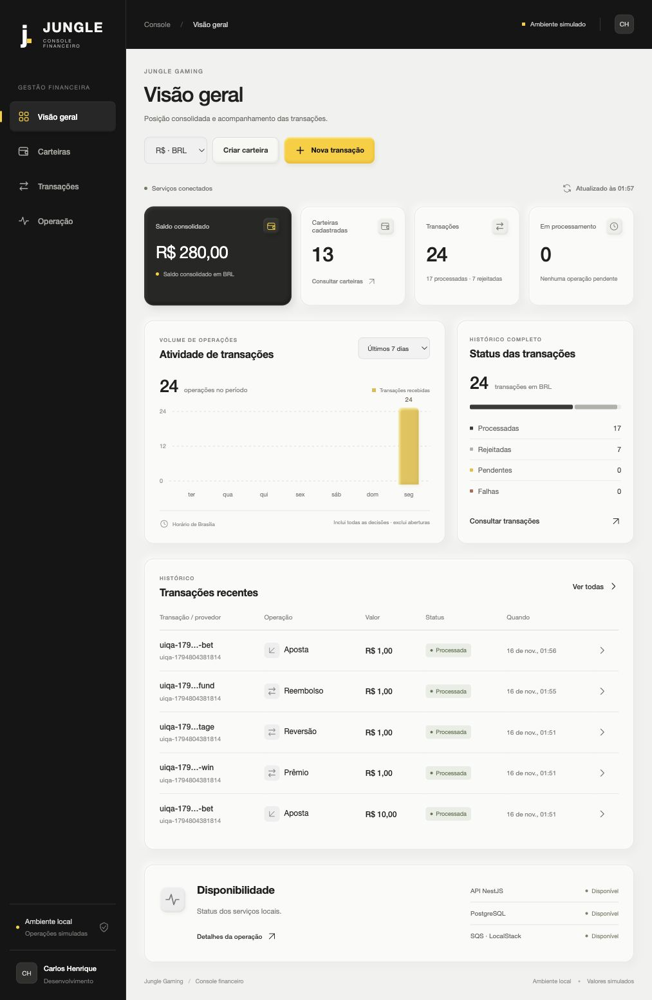
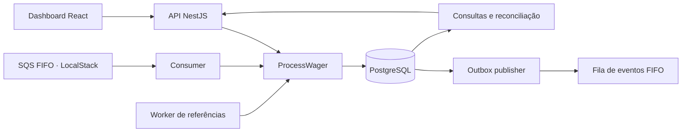

# Distributed Wagering Processor

Uma aposta de 80 em uma carteira com saldo 100 é simples. Duas apostas chegando ao mesmo tempo, uma mensagem entregue novamente e um processo caindo depois do commit tornam o problema mais interessante.

Este projeto resolve esses casos com uma API NestJS, PostgreSQL como fonte da verdade e workers sobre SQS local. HTTP e fila executam o mesmo caso de uso. Cada decisão fica registrada, o saldo pode ser reconstruído pelo extrato e uma repetição devolve o resultado original.

É uma implementação do [desafio da Jungle Gaming](https://github.com/junglegaming/backend-challenge/blob/c7143e6d041585d6913f56eb7415105e074f83dc/README.md), com uma dashboard opcional para explorar os fluxos. Tudo roda localmente, com jogadores, valores e credenciais fictícios.



## Rodando o projeto

Com Docker e Docker Compose instalados, a aplicação completa sobe com um comando:

```sh
docker compose --profile app up -d --build --wait
```

Abra **http://127.0.0.1:3100/**. O serviço `setup` aplica as migrations e cria as filas antes de iniciar a API e os workers. O banco começa vazio: crie uma carteira na interface ou execute `bun scripts/demo.ts` com Bun 1.3.14 instalado.

| Serviço | Endereço local |
|---|---|
| Dashboard e API | `http://127.0.0.1:3100` |
| PostgreSQL | `127.0.0.1:55432` |
| SQS / LocalStack | `http://127.0.0.1:4568` |
| Readiness | `http://127.0.0.1:3100/health/ready` |
| Prometheus | `http://127.0.0.1:3100/metrics` |

As portas publicadas ficam vinculadas a `127.0.0.1`. A API não implementa autenticação externa; o guard é um ponto de extensão, não uma proteção de acesso. Esta configuração não deve ser exposta na internet.

### Desenvolvimento com Bun

Para executar a aplicação fora do container e manter banco/fila no Compose:

```sh
bun install --frozen-lockfile --ignore-scripts
cp .env.example .env
docker compose up -d --wait postgres localstack
bun run migrate:up
bun run queues
bun run build:web
bun run start
```

Use apenas uma aplicação na porta 3100. Para separar API e workers, execute `WORKERS=false bun run start` em um terminal e `bun run worker` em outro. `bun run build` compila servidor e frontend; `bun run start:built` executa o servidor compilado com Bun. Depois de editar a interface, rode `bun run build:web` e recarregue a página.

Os defaults já correspondem ao `.env.example`: PostgreSQL `wager_local` / `wager_local_only` e AWS SDK `test` / `test`. A aplicação recusa destinos fora da configuração local e não descobre credenciais AWS do host.

### Stack

| Parte | Escolha |
|---|---|
| Runtime, pacotes e testes | Bun 1.3.14 |
| Linguagem / HTTP | TypeScript 5.9.3 strict / NestJS 11.1.9 |
| Persistência | PostgreSQL 17.6 / MikroORM 6.6.8 |
| Mensageria | SQS FIFO em LocalStack 4.9.2 |
| Interface | React 19.2.0, CSS e SVG locais, bundle com Bun |
| Qualidade | Biome 2.3.8, `bun test`, migrations versionadas |

Dependências diretas têm versões exatas e transitivas ficam no `bun.lock`. As imagens do Compose e do Dockerfile estão fixadas por versão e digest. Não há Prisma, CDN ou serviço de produção.

## Como uma transação atravessa o sistema



Três escolhas sustentam o processamento:

- **Concorrência por carteira.** Um lock de linha serializa operações da mesma wallet. Carteiras diferentes continuam avançando em paralelo. Com duas apostas de 80 sobre saldo 100, apenas uma é debitada.
- **Idempotência persistente.** A chave HTTP e o par provedor/ID externo são ligados ao hash dos campos de negócio. Repetição compatível devolve a decisão gravada; payload divergente gera conflito.
- **Recuperação pelo banco.** Saldo, transação, ledger, inbox e outbox confirmam juntos. O ACK vem depois do commit; o publisher envia somente eventos confirmados. Uma republicação mantém o mesmo ID de evento para deduplicação pelo consumidor.

[ARCHITECTURE.md](ARCHITECTURE.md) detalha o fluxo, as constraints, os limites das garantias e as decisões de implementação.

## Operações e dinheiro

O contrato usa valores como `{ "amount": "25.00", "currency": "BRL" }`. Internamente, dinheiro é representado em centavos com `bigint`. A API aceita BRL, USD e EUR, sempre com duas casas e valor entre `0.00` e `99999999999999.99`. Floats, expoentes, sinais e escala incorreta são rejeitados, sem arredondamento.

| Operação | Efeito no saldo | Referência |
|---|---|---|
| BET | Débito | Não aceita |
| WIN | Crédito | BET opcional |
| LOSS | Sem movimentação; valor `0.00` | Não aceita |
| REFUND | Devolve o valor integral de uma BET | Obrigatória |
| ROLLBACK | Inverte integralmente BET, WIN ou REFUND | Obrigatória |

Reversões exigem o mesmo provedor, jogador, carteira, moeda e rodada. A unicidade é por **referência e tipo**, conforme o desafio: uma referência pode ter um REFUND e um ROLLBACK. `OPENING` é exclusivamente interno. Uma abertura com saldo positivo cria o crédito e seu registro na mesma transação; saldo zero não cria lançamento.

### Um exemplo pela API

Crie uma carteira e copie o `id` retornado:

```sh
curl -sS http://127.0.0.1:3100/wallets \
  -H 'Content-Type: application/json' \
  -d '{"playerId":"0192f28f-5dc0-7d58-bdb2-814ad6a0f4a1","initialBalance":{"amount":"100.00","currency":"BRL"}}'
```

Substitua `WALLET_ID` e envie a aposta:

```sh
curl -sS http://127.0.0.1:3100/wagering/transactions \
  -H 'Content-Type: application/json' \
  -H 'Idempotency-Key: provider-a:bet-1' \
  -H 'X-Correlation-Id: local-demo-1' \
  -d '{"providerId":"provider-a","externalTransactionId":"bet-1","playerId":"0192f28f-5dc0-7d58-bdb2-814ad6a0f4a1","walletId":"WALLET_ID","roundId":"round-1","gameId":"game-1","kind":"BET","money":{"amount":"25.00","currency":"BRL"}}'
```

Repetir esse POST devolve o mesmo ID e saldo da decisão, mesmo depois de outras movimentações. Para registrar uma operação diferente, use uma nova chave e um novo ID externo.

| Método | Rota | Uso |
|---|---|---|
| POST | `/wallets` | Criar carteira |
| GET | `/wallets/:id` | Consultar saldo atual |
| GET | `/wallets/:id/ledger?limit=50&cursor=…` | Extrato paginado |
| POST | `/wallets/:id/reconciliation` | Comparar saldo e ledger, sem corrigir |
| POST | `/wagering/transactions` | Submeter com `Idempotency-Key` obrigatório |
| GET | `/wagering/transactions/:id` | Consultar decisão pelo ID interno |
| GET | `/providers/:provider/wagering/transactions/:external` | Consultar pelo ID do provedor |
| GET | `/health/live`, `/health/ready`, `/metrics` | Saúde e métricas |

O extrato retorna `items` e `nextCursor`. O cursor conserva a posição e o limite superior da primeira página; lançamentos posteriores aparecem ao iniciar uma nova consulta.

| HTTP | Interpretação |
|---:|---|
| 201 | Carteira criada |
| 200 | Processada, replay ou consulta concluída |
| 202 | Referência pendente, já persistida |
| 400 / 404 | Contrato inválido / recurso não encontrado |
| 409 | Chave, ID externo ou carteira em conflito |
| 422 | Rejeição de negócio persistida, sem movimentação |
| 500 | Decisão FAILED persistida, com ID para investigação |
| 503 | Infraestrutura indisponível; repetir a mesma operação e chave |

Os códigos estáveis e a distinção entre resposta de transporte e decisão financeira estão na [arquitetura](ARCHITECTURE.md#contrato-e-códigos-de-resposta).

### Entrada pela fila

A fila de entrada é `wager-transactions.fifo`; a DLQ é `wager-transactions-dlq.fifo`. A saída usa `wager-events.fifo`. O `MessageGroupId` é a wallet. O envelope usa os mesmos campos do POST, acrescidos da chave dentro de `data`:

```json
{
  "messageId": "msg-local-1",
  "type": "WagerTransactionRequested",
... (+72 lines) [see remaining: rtk proxy git show HEAD:README.md | tail -n +156]
