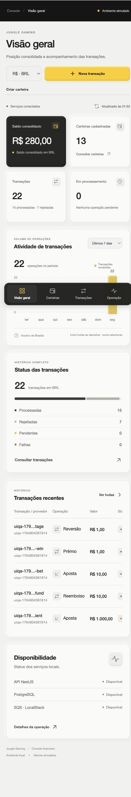
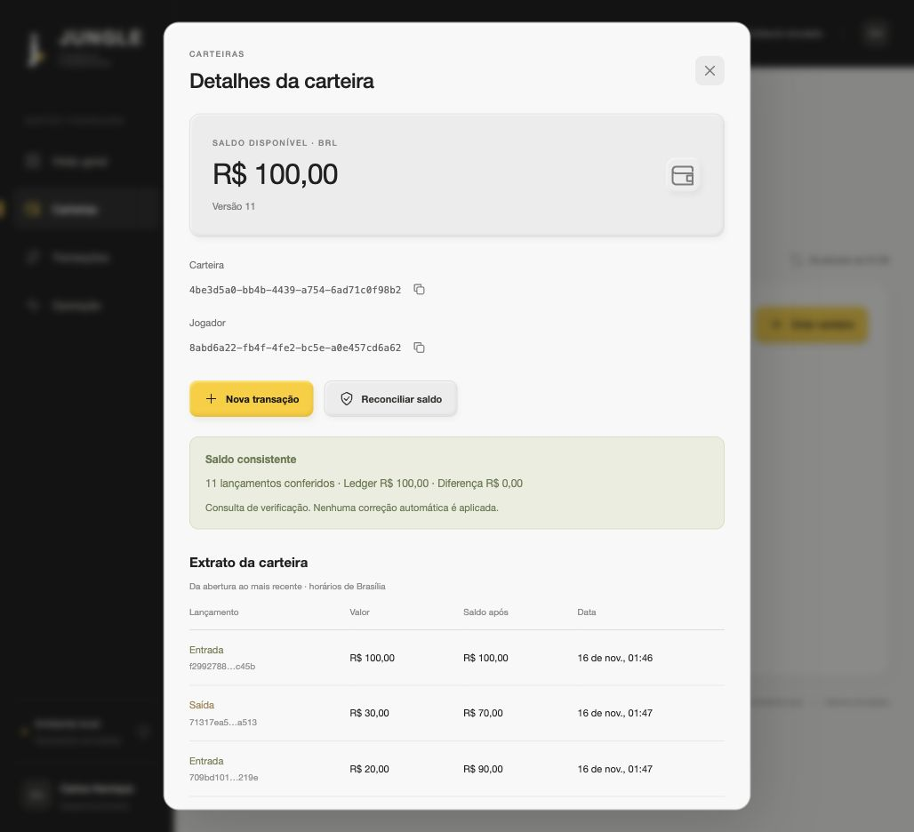

# 03 · Dashboard

[Início](../README.md) · [01](../guide/iniciar.md) · [02](../guide/api.md) · **03 · Dashboard** · [04](../ARCHITECTURE.md) · [05](../guide/testes.md) · [06](../openspec/README.md)

Abra [a dashboard local](http://127.0.0.1:3100/) depois de concluir o [setup](iniciar.md).

A interface permite criar carteiras, enviar as cinco operações, filtrar transações, consultar a decisão original e percorrer o extrato. A tela de operação mostra saúde e contagens de inbox/outbox; essas contagens não representam o tamanho das filas.

Antes de enviar, o formulário salva corpo e chave em `sessionStorage`. Em timeout ou 503, o retry reutiliza ambos, inclusive após reload na mesma aba. Uma pendência confirmada permite iniciar outra operação para fornecer a referência que falta. A atualização geral é manual; o modal de pendência consulta o resultado automaticamente, sem requisições sobrepostas.

A apresentação usa navegação escura, amarelo nas ações e superfícies com profundidade discreta. Valores de moedas diferentes não são somados nem convertidos. O layout se adapta a desktop e celular, com tabelas que têm rolagem própria.

  
  

## Um roteiro de exploração

1. Crie uma carteira com saldo `100.00` em BRL.
2. Envie uma BET de `25.00`; o saldo passa a `75.00`.
3. Consulte a decisão e abra o extrato para ver abertura e débito.
4. Envie um REFUND integral referenciando essa BET; o saldo volta a `100.00`.
5. Execute a reconciliação. O saldo reconstruído deve coincidir com o saldo da carteira.

Cada envio mantém sua chave para permitir retry seguro. A interface exibe rejeições e pendências devolvidas pela API; uma reconciliação divergente é exibida para investigação, sem alterar os registros.

---

← [Anterior: API e mensagens](../guide/api.md) &nbsp; · &nbsp; [Voltar ao início](../README.md) &nbsp; · &nbsp; [Próxima: Arquitetura →](../ARCHITECTURE.md)
