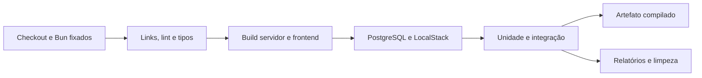

# 05 · Testes e CI

[Início](../README.md) · [01](../guide/iniciar.md) · [02](../guide/api.md) · [03](../guide/dashboard.md) · [04](../ARCHITECTURE.md) · **05 · Testes e CI** · [06](../openspec/README.md)

## Validação local

A suíte completa usa PostgreSQL e SQS reais em containers. Ela recria somente `wager_test`, limpa as filas deste projeto, inicia processos nas portas 3211–3216 e interrompe temporariamente seu PostgreSQL para testar recuperação. Pare a demo durante a execução, pois ela compartilha essas filas.

```sh
bun install --frozen-lockfile --ignore-scripts
docker compose up -d --wait postgres localstack
docker compose stop app
bun run check:docs
bun run lint
bun run typecheck
bun run build
bun test --timeout 120000
docker compose --profile app up -d --build --wait
```

`bun run test:unit` executa apenas unidade; `bun run test:integration` exige os containers e o frontend já compilado. Ausência de infraestrutura causa falha, não aprovação ou skip. Logs dos processos de teste ficam em `.artifacts/tests/`, fora do Git.

A última validação funcional registrou **75 testes aprovados, 0 falhas e 1.744 verificações**: 34 testes unitários e 41 de integração. Inclui três processos Nest, 50 envios iguais, disputa por saldo, independência entre wallets, dois publishers, morte depois do commit e antes do ACK, retry/DLQ, referências fora de ordem, migrations up/down e reconciliação após cada cenário.

Também houve verificação real da dashboard no navegador, em desktop e viewport mobile: criação, cinco operações, replay, filtros, paginação, falha do banco e retomada. Essa inspeção é distinta da suíte automatizada. O resumo e a rastreabilidade estão no [OpenSpec](../openspec/README.md).

## GitHub Actions

O workflow [CI](https://github.com/cCarllus/distributed-wagering-processor/actions/workflows/ci.yml) executa em pushes para `main`, pull requests e acionamento manual. O resultado pertence ao commit mostrado em cada execução.



| Etapa | O que verifica |
|---|---|
| Documentação | Links e imagens locais da documentação publicada |
| Lint e tipos | Biome e TypeScript strict no backend e frontend |
| Build | Compilação do servidor e bundle da dashboard |
| Testes | Suíte completa com processos reais, PostgreSQL e SQS local |
| Relatórios | JUnit, saída dos testes e logs dos containers/processos |
| Artefato | `dist/` e `public/`, somente quando a validação passa |

O runner usa Ubuntu 24.04, Bun 1.3.14 e as imagens fixadas no Compose. Actions oficiais são fixadas por SHA. As dependências são instaladas com `--frozen-lockfile --ignore-scripts`. O job tem apenas `contents: read`, não preserva credenciais no checkout e não exige secrets configurados no repositório.

O teste que interrompe PostgreSQL controla o mesmo Compose usado localmente. O shell mantém `pipefail`, portanto gravar a saída com `tee` não esconde falhas. Logs são coletados antes da limpeza, inclusive quando um passo falha. Os relatórios e arquivos compilados ficam disponíveis por sete dias nos artifacts da execução, sujeitos ao acesso ao repositório privado.

O pipeline termina no build verificado. **Deploy automático não está configurado**: não há ambiente de produção ou destino de publicação da aplicação definido.

### Investigar uma falha

1. Abra a execução do commit em **Actions → CI**.
2. Confira o primeiro passo que falhou; os posteriores podem não ter executado.
3. Baixe `diagnostics-<commit>` para consultar `junit.xml`, `test.log` e logs dos serviços.
4. Reproduza com os comandos locais acima. Não trate ausência de infraestrutura como teste aprovado.

A inspeção manual dos botões e do layout da dashboard continua separada da suíte automatizada; o CI não executa um navegador.

---

← [Anterior: Arquitetura](../ARCHITECTURE.md) &nbsp; · &nbsp; [Voltar ao início](../README.md) &nbsp; · &nbsp; [Próxima: Especificações →](../openspec/README.md)
